<p align="center">
  
</p>

<h1 align="center">Collection Sathi</h1>

<p align="center">
  <strong>Simple, local-first collection tracking — Cash + UPI, verified payments, history & instant invoices.</strong>
</p>

<p align="center">
  
  
  
  
</p>

<p align="center">
  <a href="https://vinaysoni-in.github.io/Collection-Sathi/"></a>
  &nbsp;
  <a href="https://github.com/VinaySoni-IN/Collection-Sathi/releases/latest"></a>
</p>

<p align="center">
  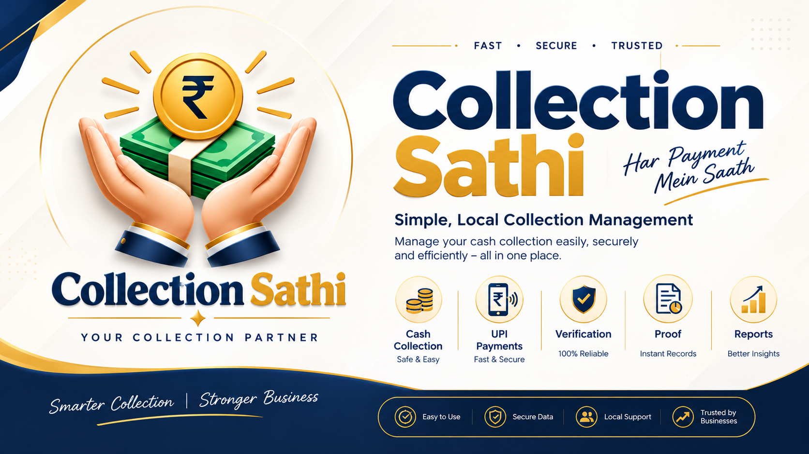
</p>

A free, open-source app to track group money collections — built for **chanda, festival funds, class collections, and community contributions**. No login, no server, no account. Everything stays on your device.

> **Simple • Local • Open Source • Collection Management**

Collection Sathi records group money collections with **Cash + UPI support**, **multi-round history**, **UPI verification**, **payment-proof image archiving**, **summaries**, **printable invoices**, and a locally saved **UPI QR code**.

---

## ✨ Features

| | |
|---|---|
| 👥 **People** | Reusable person records, no re-typing names |
| 💵📲 **Cash + UPI** | Track both, with per-entry mode |
| ✅ **UPI Verification** | Mark verified, attach proof, or self-verify |
| 🔄 **Multiple Rounds** | Independent collection sessions with full history |
| 📊 **Summary** | Totals, average, max, Cash/UPI split |
| 🧾 **Invoice** | Printable, signed, shareable as an image |
| 🔳 **UPI QR** | Save your QR once, reuse every round |
| 📄 **PDF Report** | Every transaction + every payment proof in one document |
| 💾 **Backup** | Full JSON backup & restore, plus CSV for spreadsheets |
| 📴 **Local-first** | Your data never leaves your device |

---

## 📄 Transaction report (PDF)

The **Data** tab turns a device's records into a single, printable PDF — no internet connection needed.

- **Every round, every transaction** in one numbered table: Sr. · Name · Mode · Status · Amount
- **Cash / UPI split** and round subtotals that add up to the grand total
- **Payment proofs attached** — each verified UPI payment's proof image is printed underneath the report, captioned with the payer, the round and the amount
- **Signature line** carrying the name typed on the Invoice tab
- A4, paginated, with a running header and “Page *n* of *N*”

### Pending payments page

If any UPI payment has no verified proof image, the report ends with a red **Payment verification pending** page listing exactly those payments and why each one is still open:

| Reason | Meaning |
|---|---|
| **Not verified** | Marked UPI, never verified |
| **No proof image** | Verified by tapping *Self Verified* rather than uploading a screenshot |
| **Proof image missing** | Marked as image-verified, but the stored image is gone (e.g. cleared browser data) |

The page carries a warning mark, a pending count and a pending total, so the thing that needs chasing is on paper rather than buried in the app.

Two checkboxes control the output:

| Option | Effect |
|---|---|
| **Include every round** | Off = only the round currently open |
| **Attach payment proof images** | Off = transactions only, no images (much smaller file) |

The PDF is written **entirely in the browser by a ~350-line built-in PDF engine** — no `jsPDF`, no server, no CDN. Text uses the PDF standard fonts, proof images are embedded as JPEG. On Android it opens the share sheet; elsewhere it downloads.

---

## 💾 Export & Import

Open **Data → Export / Import**.

### JSON backup — full fidelity

The JSON file is a **complete backup**, not just a dump of the text fields:

- every round, every entry, every person
- each entry's UPI verification state
- the saved **UPI QR code**
- **every payment-proof image**, embedded as a data URL

Because the proofs travel inside the file, restoring it on a new phone brings the images back too — the whole point of keeping proof.

```jsonc
{
  "app": "Collection Sathi",
  "format": "collection-sathi-backup",
  "version": 2,
  "exportedAt": "2026-10-27T11:15:00.000Z",
  "counts": { "rounds": 3, "entries": 84, "proofs": 51 },
  "state": {
    "title": "Diwali Chanda 2026",
    "signatureName": "Vinay Soni",
    "persons":  [ { "id": 1, "name": "Rahul Sharma" } ],
    "events": [ {
      "id": 3, "title": "Round 1", "date": "2026-10-21T10:00:00.000Z",
      "entries": [ {
        "id": 4, "personId": 1, "amount": 500, "mode": "upi",
        "verification": {
          "status": "verified", "method": "image",
          "proofId": "proof_9f1c…", "verifiedAt": "2026-10-21T10:05:00.000Z"
        }
      } ]
    } ],
    "currentEventId": 3,
    "nextId": 5,
    "qrImage": "data:image/jpeg;base64,…"
  },
  "proofs": [
    { "id": "proof_9f1c…", "entryId": 4, "round": "Round 1", "name": "Rahul Sharma",
      "amount": 500, "method": "image", "verifiedAt": "2026-10-21T10:05:00.000Z",
      "dataUrl": "data:image/jpeg;base64,…" }
  ]
}
```

### Two ways to import

| Mode | Behaviour |
|---|---|
| **Merge backup** | Adds rounds that aren't already on this device (matched by title + date). Existing data is never touched. People are matched by name. |
| **Replace all** | Swaps out everything stored here after a confirmation prompt. |

Import accepts a full backup (v2), a bare state object from older versions, or a raw `localStorage` dump — all three are recognised. Bad files are rejected with a message instead of corrupting the device.

### CSV — for spreadsheets

A flat, one-row-per-transaction sheet that opens in Excel, Google Sheets or Numbers:

| Round | Round date | Sr. | Name | Mode | Amount (INR) | UPI status | Proof image | Proof id | Verified at |
|---|---|---|---|---|---|---|---|---|---|
| Round 1 | 2026-10-21 | 1 | Rahul Sharma | UPI | 500 | Verified | Yes | proof_9f1c… | 2026-10-21 10:05:00 |

Written with a UTF‑8 BOM so ₹ and Devanagari names display correctly, and it ends with a summary block (total entries, total amount, cash/upi split, export time).

> **CSV is export-only.** It carries no proof images and no UPI verification links, so restoring from it would silently lose information. Use JSON to restore, CSV to analyse.

---

## 🧭 Sections

| Collect | Summary | History | Invoice | Data |
|---|---|---|---|---|
| Add & verify payments | Totals & stats | All rounds, switch anytime | Print, PDF, share | Report, export, import |

---

## 📱 Screenshots

<table>
<tr>
<td align="center">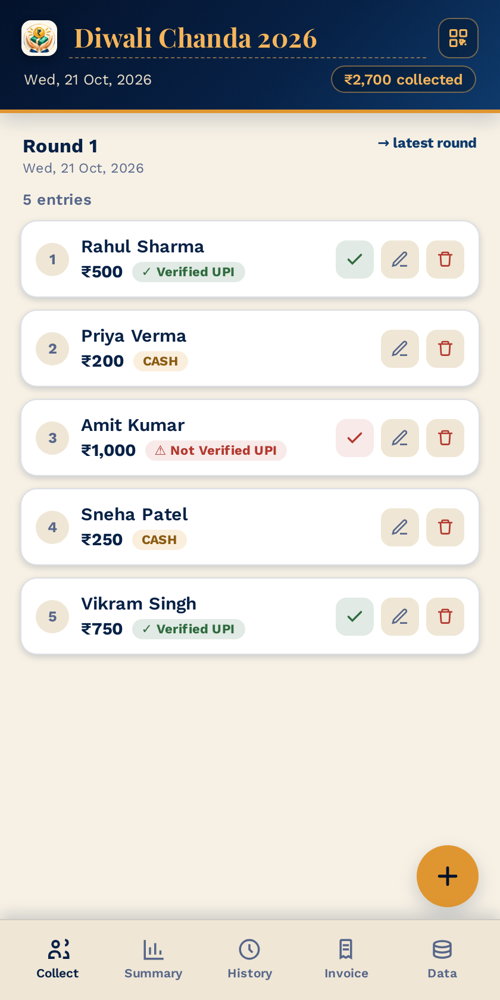<br><sub>Collect</sub></td>
<td align="center">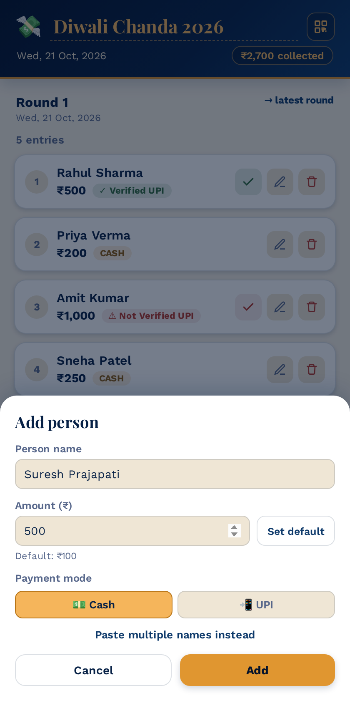<br><sub>Add person</sub></td>
<td align="center">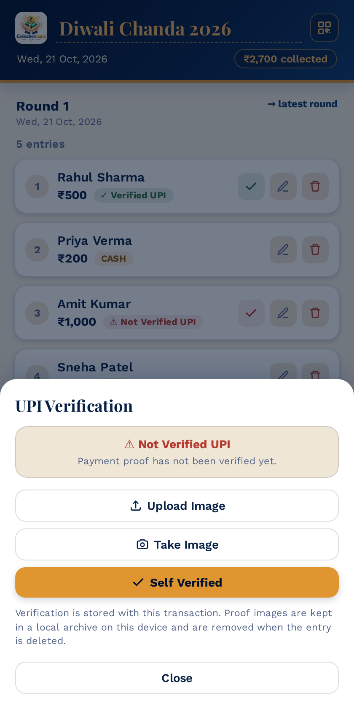<br><sub>UPI verification</sub></td>
</tr>
<tr>
<td align="center">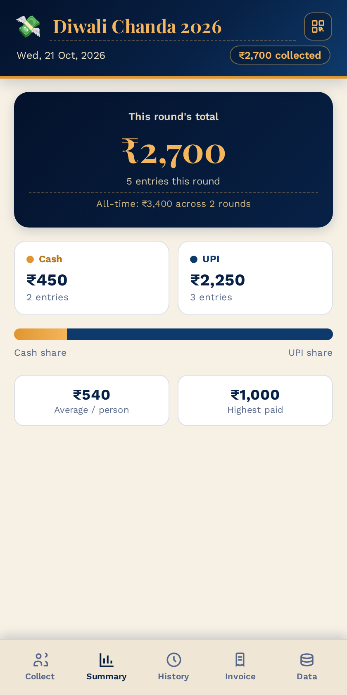<br><sub>Summary</sub></td>
<td align="center">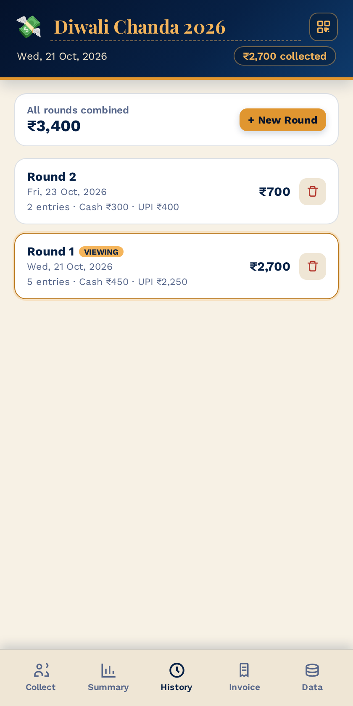<br><sub>History</sub></td>
<td align="center">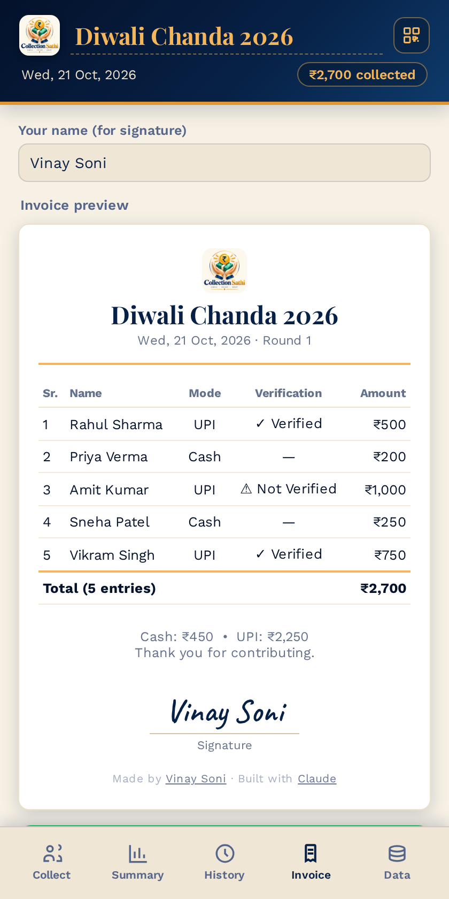<br><sub>Invoice</sub></td>
</tr>
<tr>
<td align="center">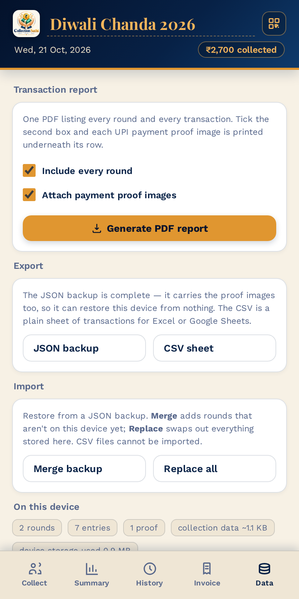<br><sub>Report, export &amp; import</sub></td>
<td align="center">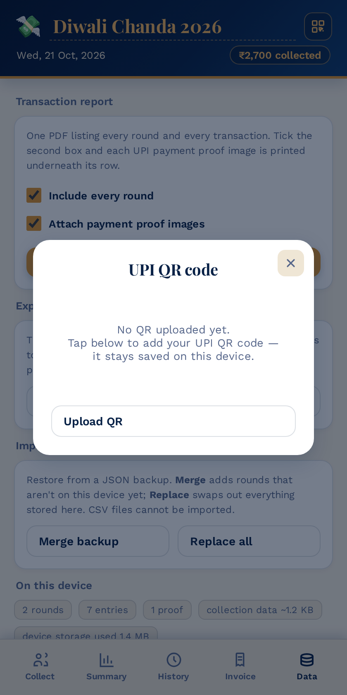<br><sub>UPI QR code</sub></td>
<td align="center">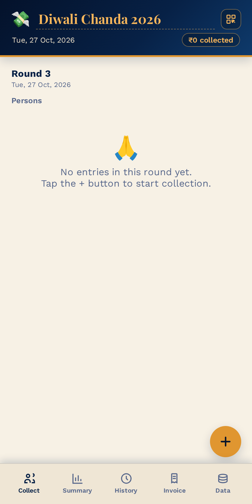<br><sub>Empty round</sub></td>
</tr>
</table>

---

## 🎨 Visual identity

The app, its icons and the PDF report all draw from one five-colour palette:

| Swatch | Hex | Used for |
|---|---|---|
| Deep navy | `#072146` | Header, primary text, invoice headings, PDF cover |
| Gold | `#E09630` | Primary buttons, accents, totals |
| Light gold | `#F5B55B` | Header title, cash bars, highlights |
| Cream | `#F7F1E5` | App background |
| White | `#FFFFFF` | Cards and panels |

Supporting tints (deep navy `#0A2A52` for UPI, `#B87517` for gold-on-cream text, `#2F6B3F` for verified, `#B4382E` for unverified) are derived from those five. Every colour in the codebase is a CSS custom property in `:root`, so retheming is a five-line change.

Typography is **Playfair Display** for headings and figures, **Work Sans** for body, **Caveat** for the invoice signature.

---

## 🛠️ Tech Stack

Plain HTML, CSS & JavaScript — no framework, no build step, no package manager.

`localStorage` · `IndexedDB` · Canvas API · Web Share API · Service Worker · Web App Manifest · built-in PDF writer

The only external request at runtime is **Google Fonts**. `html2canvas` is vendored into `vendor/` and pinned with a Subresource Integrity hash, so the app and its invoice sharing both work with no connection.

---

## 🗂️ File Structure

```text
Collection-Sathi/
│
├── index.html              # App UI, CSS, JavaScript and the PDF engine (self-contained)
├── manifest.json           # PWA config — name, icons, theme
├── sw.js                   # Service worker (installable + offline)
├── icon-192.png            # App icon (small, rounded)
├── icon-512.png            # App icon (large, rounded)
├── apple-touch-icon.png    # iOS home-screen icon (square, iOS masks it)
├── favicon-64.png          # Browser favicon
├── vendor/
│   └── html2canvas.min.js  # Vendored + SRI-pinned (invoice image share)
├── Banner.png              # README banner
├── screenshots/            # Screenshots used in this README
├── LICENSE                 # MIT License
└── README.md               # This file
```

---

## 🔄 How It Works

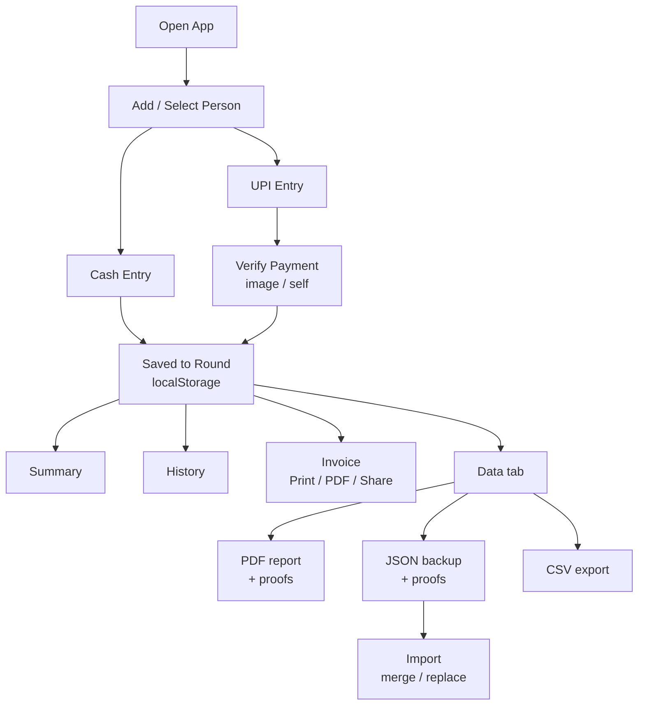

---

## 🧱 Data Model

Everything except proof images lives in **one JSON document** in `localStorage` under the key `collection_sathi_v2`. Proof images live in **IndexedDB** (`collection_sathi_proofs_v1`), and entries only hold a small reference to them.

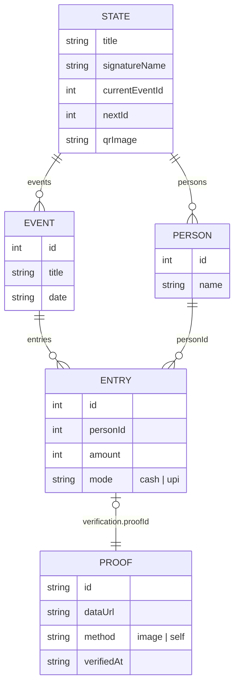

`nextId` is a single counter shared by persons, rounds and entries, so no id is ever reused. `load()` runs a repair pass on every boot: missing or duplicated ids are renumbered, `nextId` is raised above every stored id, amounts are coerced to non-negative integers, and verification records are dropped from entries that are no longer UPI. That is what keeps older backups importable.

---

## 🏗️ Architecture

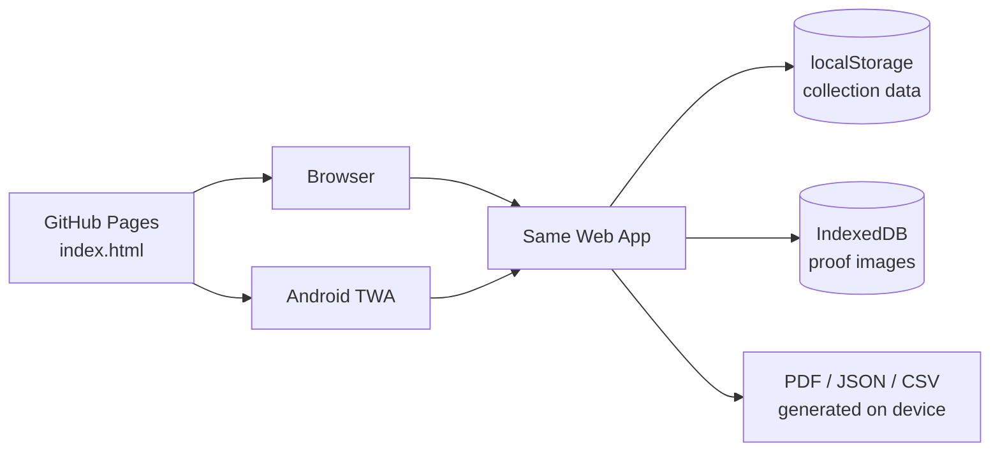

---

## 🚧 Production Readiness

Functional and in everyday use for real collections, still short of a finished v1.

**Ready:** core collection flow · invoices (print / share) · UPI verification + proof archiving · multi-round history · installable PWA · **PDF transaction report with proofs** · **JSON backup & restore** · **CSV export** · data repair for older stored data · offline-capable service worker · dialog semantics, focus trapping and Escape-to-close

**Not yet ready:** cross-device sync (by design — the app is local-only) · cross-device testing · signed release APK · versioned releases

> Keep a JSON backup. Data lives in this browser only — clearing site data, uninstalling the app, or browsing in private mode will erase it.

---

## 🗺️ Roadmap

- [x] Export / Import (JSON with proofs, CSV export)
- [x] PDF report with attached payment proofs
- [x] Repair pass for legacy / corrupted stored data
- [x] Auto-delete proof images when their entry or round is deleted
- [x] One-tap cleanup for orphaned proof images
- [x] Offline-capable, self-updating service worker
- [x] Full keyboard and screen-reader support in dialogs
- [ ] Auto-backup reminder (nudge after N days without an export)
- [ ] Search & filter entries
- [ ] Proof archive viewer
- [ ] Dark mode
- [ ] Marathi / Hindi interface
- [ ] Signed, versioned APK releases
- [ ] F-Droid listing
- [ ] Optional encrypted backup

---

## 🤝 Contributing & Contribution Flow

Contributions are welcome — keep changes compatible with existing stored data (a backup from an older version must still import), and test on a real phone before submitting.

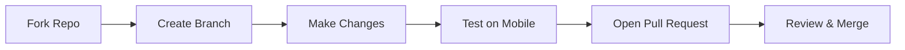

There is no build step and no test suite, so a pull request is just an edited `index.html`. Things worth knowing before you dig in:

| Concern | Where |
|---|---|
| Storage, state, `load()` / `save()` | top of the IIFE |
| Totals | `computeTotals()` / `computeAllTime()` — reused by header, summary, history, invoice and the PDF |
| Escaping | `escapeHtml()` — applied to every interpolated string |
| Rendering | `renderEntries` · `renderSummary` · `renderHistory` · `renderInvoice` · `renderAll` |
| PDF engine | `PdfEngine` — `buildReport(model)` takes a plain model object |
| Export / import | `buildBackupPayload` · `buildCsv` · `parseBackup` · `importBackup` |
| Proof archive | IndexedDB helpers near `getProofDb()` |

---

<p align="center">
<sub>
Collection Sathi is provided “as is” without warranty of any kind — the developer is not liable for any loss of data, funds, or disputes arising from its use. All collection data is stored locally on your device; nothing is uploaded to any server, and you are solely responsible for backing up and verifying your own records. This project is licensed under the <a href="LICENSE">MIT License</a> — free to use, modify, and share, with attribution appreciated. Built with respect and gratitude for the open-source community that makes projects like this possible.
</sub>
</p>

<p align="center">
<sub>
Made with ❤️ by <a href="https://github.com/VinaySoni-IN">Vinay Soni</a> · Built with <a href="https://claude.ai">Claude</a>
</sub>
</p>
